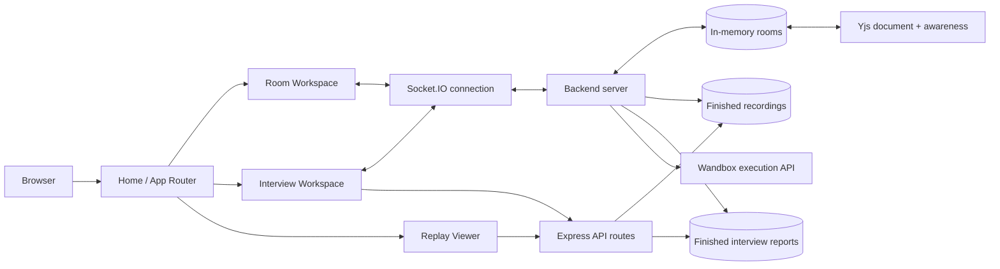
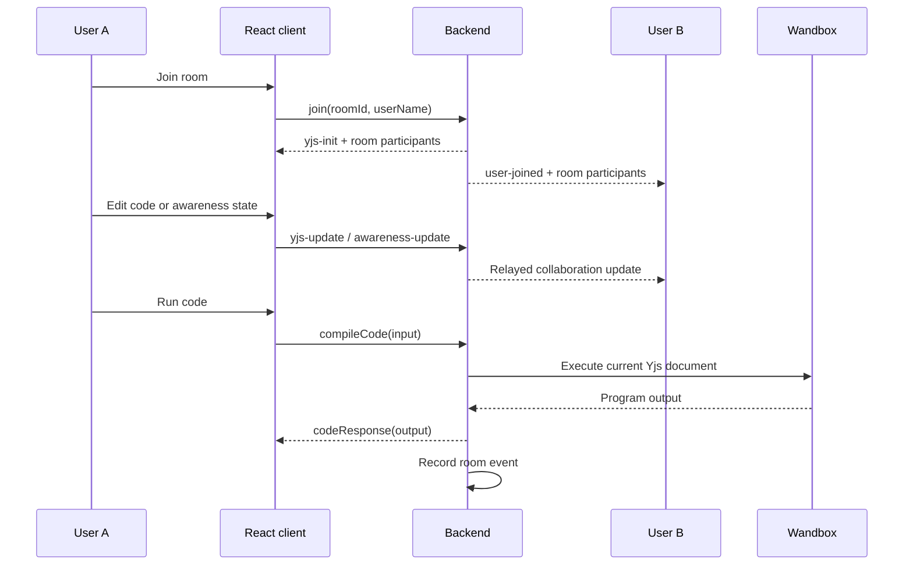

# PairPad

PairPad is a real-time collaborative coding workspace for live pairing, technical interviews, sandboxed execution, and session replay.

Work together in the same editor, see collaborators as they type, run code without executing it on your machine, and review completed sessions afterward.

> A full-stack collaborative IDE built with React, Node.js, Socket.IO, Yjs, Monaco Editor, WebRTC, and Wandbox.

[](https://react.dev/)
[](https://nodejs.org/)
[](https://socket.io/)
[](https://yjs.dev/)
[](https://vite.dev/)

## At a glance

PairPad solves the problem of coordinating live coding sessions in one browser workspace:

- **Collaborate** in the same Monaco-powered editor with conflict-free Yjs synchronization.
- **Interview** with private interviewer/candidate flows, timed sessions, submissions, and hidden tests.
- **Execute** JavaScript, Python, C++, and Java through a server-side Wandbox integration.
- **Call** teammates through peer-to-peer WebRTC video with Socket.IO signaling and optional TURN.
- **Replay** recorded coding sessions, including document changes, joins, leaves, language changes, runs, and interview marks.

## What makes it resume-worthy

- Designed a real-time multi-user architecture using **Socket.IO rooms**, **Yjs CRDT updates**, and **awareness state** for low-conflict collaborative editing.
- Built a complete interview workflow with role-aware authorization, interviewer-only configuration, timed sessions, submission cooldowns, hidden tests, and post-session reports.
- Added a server-side execution boundary so user code runs through a sandbox service instead of directly on the application host.
- Implemented replay recording with bounded event counts, byte limits, retention windows, rate limiting, and graceful handling of live/truncated recordings.
- Added WebRTC mesh video calling with mic/camera state, peer lifecycle handling, ICE/TURN configuration, and per-socket signaling limits.
- Kept the frontend modular with query-based routing, reusable UI components, Monaco editor integration, and shared design tokens.

## Core stack

| Layer | Technologies |
| --- | --- |
| Frontend | React 19, Vite, Monaco Editor, y-monaco, Socket.IO Client |
| Collaboration | Yjs CRDT, y-protocols awareness, Socket.IO |
| Calls | WebRTC peer connections, Socket.IO signaling, STUN/TURN |
| Backend | Node.js, Express 5, Socket.IO |
| Execution | Axios + Wandbox compiler/execution API |
| Delivery | Vite production build, Express static hosting and SPA fallback |

## Resume-ready project description

> **PairPad — Real-time collaborative coding and interview platform**
> Built a full-stack browser IDE with React, Node.js, Socket.IO, Yjs CRDT synchronization, Monaco Editor, WebRTC video calling, sandboxed multi-language execution, interview workflows, and session replay. Implemented role-aware interview authorization, hidden-test judging, bounded replay storage, rate limiting, ICE/TURN configuration, and responsive reusable UI components.

## Why PairPad

- **Collaborative rooms** — Join a room with a name and room ID, then edit together in real time.
- **Conflict-free synchronization** — Yjs CRDT updates keep concurrent edits mergeable.
- **Live presence** — See collaborators, cursor positions, selections, and names.
- **Sandboxed execution** — Run JavaScript, Python, C++, and Java with stdin support through the backend execution service.
- **Interview mode** — Create private interviewer links, configure a problem and timer, and judge submissions against hidden test cases.
- **Session replay** — Record room activity and replay finished sessions from a shareable room link.
- **Light theme** — A consistent light workspace across the Home, room, interview, and replay flows.
- **Responsive Home experience** — The landing page includes navigation, quick actions, product explanations, and mobile layouts.

## Screens and workflows

### Join or create a room

1. Enter your name.
2. Enter an existing room ID or generate one.
3. Join the room.

The room URL uses the existing format:

```text
/?room=<room-id>&name=<display-name>
```

### Start an interview

1. Enter the interviewer’s name.
2. Create an interview.
3. Share the private candidate link.
4. Configure the problem and timer.
5. Start the interview and review submissions.

The interviewer key and name are stored locally per interview room so the interviewer can reconnect to the session.

### Watch a replay

Enter a completed room ID to open its replay:

```text
/?replay=<room-id>
```

### Interview routes

Interview sessions use the existing query format:

```text
/?interview=<room-id>
```

## Video calls

Video calls are peer-to-peer WebRTC mesh sessions established through Socket.IO signaling. Each participant connects to every other peer; the mesh scales well for about 4-5 participants. The UI provides mic and camera toggles, mute indicators, and a "Leave call" button.

- **How to start**: Open two (or more) tabs with the same `?room=<id>&name=<name>` query, click "Enable video" (or "Join call"), and allow microphone/camera permission.
- **TURN configuration**: The backend reads `TURN_URLS` (comma-separated), `TURN_SECRET` (enables short-lived credentials), and `TURN_USERNAME`/`TURN_CREDENTIAL` (static fallback). By default only STUN is provided via `GET /api/ice-config`. To use TURN, set the env variables and restart the backend; the ice-config endpoint will then include TURN server entries with appropriate credentials.
- **How to test**: Open two tabs in the same room with headphones to avoid feedback; then try two different network profiles (e.g., home Wi-Fi vs mobile hotspot) to verify TURN traversal. The localStream should have `videoWidth > 0` once the remote peer's video track is received.

### Socket events (WebRTC mesh)

The following Socket.IO events are used for video call signaling. All names are confirmed against `Backend/index.js`:

| Event | Payload | Description |
|---|---|---|
| `video-join` | `{ audio: boolean, video: boolean }` | Client joins the call; server replies with `video-peers` and broadcasts `video-peer-joined` to others |
| `video-leave` | (none) | Client leaves the call; server broadcasts `video-peer-left` for the departing member |
| `video-state` | `{ audio: boolean, video: boolean }` | Updates the caller's audio/video flags; server broadcasts `video-peer-state` to others |
| `video-peers` | `{ id, name, audio, video }[]` | Reply to `video-join` listing all current call members |
| `video-peer-joined` | `{ id, name, audio, video }` | Broadcast when a new member joins the call (others' side) |
| `video-peer-left` | `{ id }` | Broadcast when a member leaves or disconnects |
| `video-peer-state` | `{ id, audio, video }` | Broadcast when a member toggles mic/camera |

Real-time room and interview operations use Socket.IO rather than REST endpoints.

### HTTP API (updated)

The frontend also uses these HTTP endpoints for post-session data:

| Method | Endpoint | Purpose |
|---|---|---|
| `GET` | `/api/replay/:roomId` | Fetch a finished room recording |
| `GET` | `/api/interview/:roomId/report` | Fetch a finished interview report |
| `GET` | `/api/ice-config` | ICE configuration (STUN by default; TURN when `TURN_URLS`/`TURN_SECRET` are set) |

Security and resource limits

PairPad includes server-side safeguards for the existing workflows:

- Code and binary update payload limits.
- Replay event and recording-size limits.
- Replay and report rate limiting.
- Interview submission limits and cooldowns.
- Hidden interview tests remain server-side.
- Input and output are bounded before being returned to clients.

Code execution depends on the public Wandbox service. Its availability and startup capacity can affect execution and judging results; infrastructure failures are handled separately from ordinary compile or answer failures.

## Architecture

PairPad is a small full-stack JavaScript application:

```text
PairPad/
├── Backend/
│   ├── index.js        Server bootstrap and Socket.IO room coordination
│   ├── config/         Environment-backed limits and service constants
│   ├── routes/         HTTP API and static frontend routes
│   ├── services/       External execution services such as Wandbox
│   ├── utils/          Shared validation and security helpers
│   └── problems.js     Interview problem definitions and test data
├── Frontend/
│   ├── src/
│   │   ├── App.jsx     Query-parameter router
│   │   ├── Home.jsx    Landing page and existing Home workflows
│   │   ├── Room.jsx    Collaborative room UI
│   │   ├── Interview.jsx
│   │   ├── Replay.jsx
│   │   ├── socket.js   Shared Socket.IO client
│   │   ├── yjsProvider.js
│   │   ├── components/
│   │   ├── hooks/
│   │   └── styles/
│   ├── vite.config.js  Vite development server and backend proxy
│   └── package.json
├── package.json
└── README.md
```

### System design



### Collaboration flow



### Module ownership

| Area | Owns | Main entry points |
| --- | --- | --- |
| Routing | Query-based screen selection | `Frontend/src/App.jsx` |
| Room UI | Editor, participants, video controls, and panels | `Frontend/src/Room.jsx`, `Frontend/src/components/` |
| Collaboration | Socket.IO events and Yjs synchronization | `Backend/index.js`, `Frontend/src/yjsProvider.js` |
| HTTP API | Replay, interview reports, and static frontend delivery | `Backend/routes/api.js` |
| Execution | Code execution and interview judging requests | `Backend/services/wandbox.js` |
| Limits and validation | Environment limits, payload validation, and timing-safe keys | `Backend/config/constants.js`, `Backend/utils/validation.js` |

### Frontend

- React 19
- Vite
- Monaco Editor
- Yjs and y-monaco
- Socket.IO client
- CSS custom properties for the light design system and editor themes

### Backend

- Node.js with Express
- Socket.IO for room collaboration and interview events
- Yjs document synchronization and awareness updates
- In-memory active rooms and finished recordings
- Modular Axios integration with Wandbox for code execution and judging

The current server keeps active room state and finished recordings in memory. Restarting the backend clears that in-memory state.

## Important server events

The frontend and backend communicate through the existing Socket.IO protocol. Main event families include:

- Normal rooms: `join`, `leave-room`, `yjs-update`, `awareness-update`, `languageChange`, `compileCode`
- Interviews: `create-interview`, `join-interview`, `interview-configure`, `interview-start`, `interview-end`, `interview-submit`
- Connection and state updates: `connect`, `disconnect`, `yjs-init`, `interview-state`, `codeResponse`

These event names and payload contracts are part of the application behavior and should not be changed casually.

## Requirements

- Node.js 20 or newer is recommended.
- npm
- Network access for:
  - Wandbox code execution and judging
  - Google Fonts in the default development HTML

## Installation

Clone the repository and install both workspaces:

```bash
git clone <your-repository-url>
cd Collaborate-code
npm install
cd Frontend
npm install
cd ..
```

## Environment variables

Copy the example file:

```bash
cp Frontend/.env.example Frontend/.env
```

Available frontend variables:

| Variable | Purpose | Default |
| --- | --- | --- |
| `VITE_SOCKET_URL` | Socket.IO backend URL when the frontend is hosted separately | Empty; Vite proxy is used locally |
| `VITE_GITHUB_URL` | GitHub link shown in the Home footer and navbar | `https://github.com/vivekcode12345` |

Backend variables:

| Variable | Purpose | Default |
| --- | --- | --- |
| `PORT` | HTTP and Socket.IO server port | `5000` |
| `ALLOWED_ORIGIN` | Socket.IO CORS origin | `*` |
| `REPLAY_MAX_EVENTS` | Maximum replay events retained per recording | `20000` |
| `REPLAY_RATE_MAX` | Replay API requests allowed per rate-limit window | `20` |
| `REPLAY_RATE_WINDOW_MS` | Replay API rate-limit window | `60000` |
| `INTERVIEW_MAX_SUBMISSIONS` | Maximum submissions per interview | `5` |

Additional interview limits are defined in `Backend/index.js` and use safe defaults when not configured.

## Development

Start the backend from the repository root:

```bash
npm start
```

Start the Vite frontend in a second terminal:

```bash
cd Frontend
npm run dev
```

Open:

```text
http://localhost:5173
```

During development, Vite proxies `/socket.io` and `/api` requests to `http://localhost:5000`.

For automatic backend restarts:

```bash
npm run dev
```

## Production build

Build the frontend:

```bash
cd Frontend
npm run build
```

Or use the root build command:

```bash
npm run build
```

The root build installs dependencies, builds the frontend, and produces the Vite output in `Frontend/dist`.

The backend serves the built frontend and provides SPA fallback handling for the query-parameter routes.

## Validation

Run the available frontend checks:

```bash
cd Frontend
npm run lint
npm run build
```

Backend syntax can be checked with:

```bash
node --check Backend/index.js
```

There is currently no automated test suite configured in the repository. Manual smoke testing should cover:

1. Home page at desktop and mobile widths.
2. Room ID generation and room joining.
3. Two browser windows editing the same room.
4. Code execution for each supported language.
5. Interview creation, candidate joining, submission, and report access.
6. Replay creation and playback.
7. Light-theme rendering across all application flows.

## API endpoints

The frontend uses these HTTP endpoints for post-session data:

| Method | Endpoint | Purpose |
| --- | --- | --- |
| `GET` | `/api/replay/:roomId` | Fetch a finished room recording |
| `GET` | `/api/interview/:roomId/report` | Fetch a finished interview report |

Real-time room and interview operations use Socket.IO rather than REST endpoints.

## Security and resource limits

PairPad includes server-side safeguards for the existing workflows:

- Code and binary update payload limits.
- Replay event and recording-size limits.
- Replay and report rate limiting.
- Interview submission limits and cooldowns.
- Hidden interview tests remain server-side.
- Input and output are bounded before being returned to clients.

Code execution depends on the public Wandbox service. Its availability and startup capacity can affect execution and judging results; infrastructure failures are handled separately from ordinary compile or answer failures.

## Design system

The frontend uses shared CSS tokens for:

- Warm gold accents
- Light and dark surfaces
- Text and muted-text contrast
- Border radii and spacing
- Control heights
- Shadows
- Syntax highlighting

Home-only presentation is split across reusable components such as the navbar, command palette, hero preview, feature sections, how-it-works section, and CTA band. Existing Room, Interview, and Replay functionality continues to use the shared application components and legacy styles where required.

## Contributing

When making changes:

1. Preserve Socket.IO event names and payloads.
2. Preserve room, interview, and replay URL formats.
3. Do not expose hidden tests or interviewer-only data to candidates.
4. Keep changes scoped to the relevant screen or subsystem.
5. Run lint, build, and the relevant manual workflow checks.
6. Do not commit secrets or local `.env` files.

## License

This repository does not currently declare a project-specific open-source license. Add an explicit license before publishing PairPad for external redistribution.
